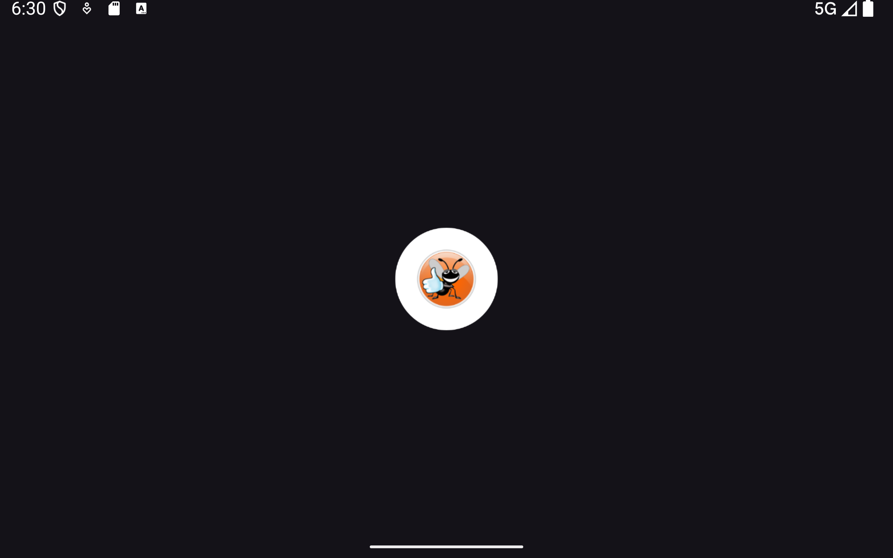
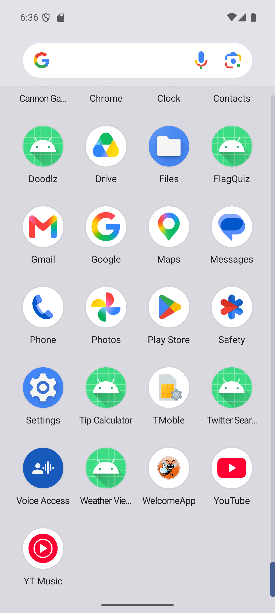

# WelcomeApp

App de bienvenida para Android: un mensaje y una imagen que ocupan cada uno la mitad de la pantalla, con accesibilidad para TalkBack, textos en inglés y español, y un tamaño de letra mayor en tablets.

Es la migración del **capítulo 2 de Deitel (2016)**, escrito para Android 6 con Android Studio 1.x, a **Kotlin y Android 16 (API 36)**.


-lightgrey>)

> **Práctica 02** · Aplicaciones Móviles · Universidad Técnica de Ambato, FISEI
> Autor: Acosta Nuñez Edison Joel · Docente: Ing. Aladaz Flores Clay Fernando

---

## Capturas

<table>
  <tr>
    <td align="center"><br><sub>Teléfono, vertical</sub></td>
    <td align="center"><br><sub>Español (values-es)</sub></td>
    <td align="center"><br><sub>Modo oscuro</sub></td>
  </tr>
  <tr>
    <td align="center"><br><sub>Fuente del sistema al 200 % (sp)</sub></td>
    <td align="center"><br><sub>Ícono en el lanzador</sub></td>
    <td align="center"><br><sub>Lint: 0 errores</sub></td>
  </tr>
</table>

<table>
  <tr>
    <td align="center"><br><sub>Teléfono, horizontal: 40sp</sub></td>
    <td align="center"><br><sub>Tablet: 80sp (values-w600dp-h600dp)</sub></td>
  </tr>
</table>

---

## Funcionalidades

- **Mensaje e imagen** en un `LinearLayout` vertical, cada uno con la mitad de la altura (`layout_weight`).
- **Texto escalable:** 40sp en teléfono y 80sp en pantallas de al menos 600×600dp, sin código, por recursos alternativos.
- **Accesibilidad:** la imagen tiene `contentDescription` para TalkBack y el color del texto cumple WCAG AA sobre fondo claro.
- **Inglés y español:** Android elige `values-es` según el idioma del dispositivo, incluido `es-EC`.
- **Edge-to-edge:** el contenido respeta las barras del sistema de Android 15+.
- **Modo oscuro** heredado del tema Material 3 DayNight.

---

## Qué cambió respecto al libro

|                    | PDF (2016)                               | Este proyecto                                |
| ------------------ | ---------------------------------------- | -------------------------------------------- |
| Lenguaje           | Java (plantilla)                         | Kotlin                                       |
| Bibliotecas        | Support Library                          | AndroidX y Material 3                        |
| SDK                | min 23                                   | min 24 · target 36 · compile 37              |
| Layout inicial     | `RelativeLayout`                         | Cambiado a `LinearLayout`, como pide el PDF  |
| Color del texto    | `#2196F3` (3,1:1 sobre blanco)           | `#1565C0` (5,7:1 sobre blanco)               |
| Barras del sistema | Opacas                                   | Edge-to-edge con insets                      |
| Tablet             | El texto dice `values-xlarge`; crea otra | `values-w600dp-h600dp`, verificado en tablet |
| Prueba en español  | App Custom Locale                        | Ajustes del sistema o `adb`                  |

- **Correcciones de compatibilidad**, una por fila: [docs/COMPATIBILIDAD.md](docs/COMPATIBILIDAD.md)
- **Análisis de diseño**, errores del libro y deuda técnica: [docs/ANALISIS_DISENO.md](docs/ANALISIS_DISENO.md)

---

## Arquitectura

Una Activity y un layout. No hay lógica de negocio, así que no hay ViewModel ni casos de uso: **el diseño de esta práctica está en los recursos, no en las clases.**

```
LinearLayout  welcomeLinearLayout   (vertical)
├── TextView  welcomeTextView       peso 1 → mitad superior
└── ImageView bugImageView          peso 1 → mitad inferior
```

Resolución de recursos, insets y decisiones: [docs/ARQUITECTURA.md](docs/ARQUITECTURA.md)

---

## Tecnologías

| Herramienta                        | Versión                   |
| ---------------------------------- | ------------------------- |
| Android Gradle Plugin              | 9.3.2 (Kotlin integrado)  |
| Gradle                             | 9.5.0                     |
| JVM del daemon de Gradle           | 25 (toolchain automática) |
| compileSdk / targetSdk / minSdk    | 37 / 36 / 24              |
| Bytecode                           | Java 11                   |
| AndroidX Core, AppCompat, Activity | 1.19.0, 1.8.0, 1.13.0     |
| Material Components                | 1.14.0                    |
| JUnit, AndroidX JUnit, Espresso    | 4.13.2, 1.3.0, 3.7.0      |

Las versiones están centralizadas en [`gradle/libs.versions.toml`](gradle/libs.versions.toml).

---

## Cómo ejecutarlo

Requisitos: Android Studio con el SDK de Android 37. Gradle descarga el JDK que necesita.

```bash
git clone <url-del-repositorio>
cd P02_WelcomeApp

gradlew assembleDebug        # compilar
gradlew installDebug         # instalar en el emulador o dispositivo conectado
```

---

## Verificación

```bash
gradlew test                        # 1 unitaria (plantilla)
gradlew connectedDebugAndroidTest   # 1 instrumentada (plantilla)
gradlew lint                        # 0 errores; incluye MissingTranslation y ContentDescription
```

Las dos pruebas automáticas son las de la plantilla. Lo que esta app necesita verificar son sus recursos, y eso se hace con Lint, el cálculo de contraste y capturas en teléfono y tablet: [docs/PRUEBAS.md](docs/PRUEBAS.md)

---

## Documentación

| Documento                                     | Contenido                                          |
| --------------------------------------------- | -------------------------------------------------- |
| [COMPATIBILIDAD.md](docs/COMPATIBILIDAD.md)   | Correcciones del PDF a API 36                      |
| [ANALISIS_DISENO.md](docs/ANALISIS_DISENO.md) | Principios, errores del libro y deuda técnica      |
| [ARQUITECTURA.md](docs/ARQUITECTURA.md)       | Layout, recursos alternativos, insets y decisiones |
| [PRUEBAS.md](docs/PRUEBAS.md)                 | Lint, contraste, verificación manual y límites     |
| [PLAN.md](docs/PLAN.md)                       | Fases de desarrollo y sus commits                  |

---

## Estructura

```
P02_WelcomeApp/
├── app/src/
│   ├── main/
│   │   ├── java/ec/edu/uta/fisei/welcomeapp/
│   │   │   ├── core/ domain/ data/   Vacías (convención del curso, ver ANALISIS §2)
│   │   │   └── ui/welcome/           MainActivity
│   │   └── res/
│   │       ├── layout/               activity_main.xml
│   │       ├── drawable/             bug.png
│   │       ├── values/               strings, dimens (40sp), colors, themes
│   │       ├── values-es/            strings en español
│   │       ├── values-w600dp-h600dp/ dimens (80sp)
│   │       └── values-night/         tema oscuro
│   ├── test/                         Prueba unitaria de plantilla
│   └── androidTest/                  Prueba instrumentada de plantilla
├── docs/                             Documentación y capturas
└── gradle/                           Catálogo de versiones
```

---

## Convenciones

- **Nombres del PDF:** `welcomeLinearLayout`, `welcomeTextView`, `bugImageView`, `welcome`, `deitel_logo` y `welcome_textsize` se conservan tal cual para poder rastrearlos en el libro.
- **Commits:** en fases (`Fase N:`), con correcciones (`fix:`) y mantenimiento (`chore:`).
- **Referencias al libro:** `PDF 2.5.6`, `Fig. 2.12`, etc.

---

## Limitaciones conocidas

Detalladas con su riesgo y la acción propuesta en [ANALISIS_DISENO.md §7](docs/ANALISIS_DISENO.md). Las principales:

- El listener de insets reemplaza el padding de 16dp del layout, así que en vertical el texto llega a los bordes.
- El ícono del lanzador es el de la plantilla; el paso 2.5.2 del PDF no se aplicó.
- En modo oscuro, el color del texto queda cerca de 3:1.
- TalkBack no se verificó con el lector de pantalla activo.

---

## Créditos

- Basado en el capítulo 2 (Welcome App) de P. Deitel, H. Deitel y A. Wald, _Android 6 for Programmers: An App-Driven Approach_, 3.ª ed., Pearson, 2016. Uso académico.
- `bug.png`: logo de Deitel & Associates, incluido con los ejemplos del libro. Uso académico; el PDF (nota 1, §2.5.1) advierte verificar la licencia antes de distribuir.
