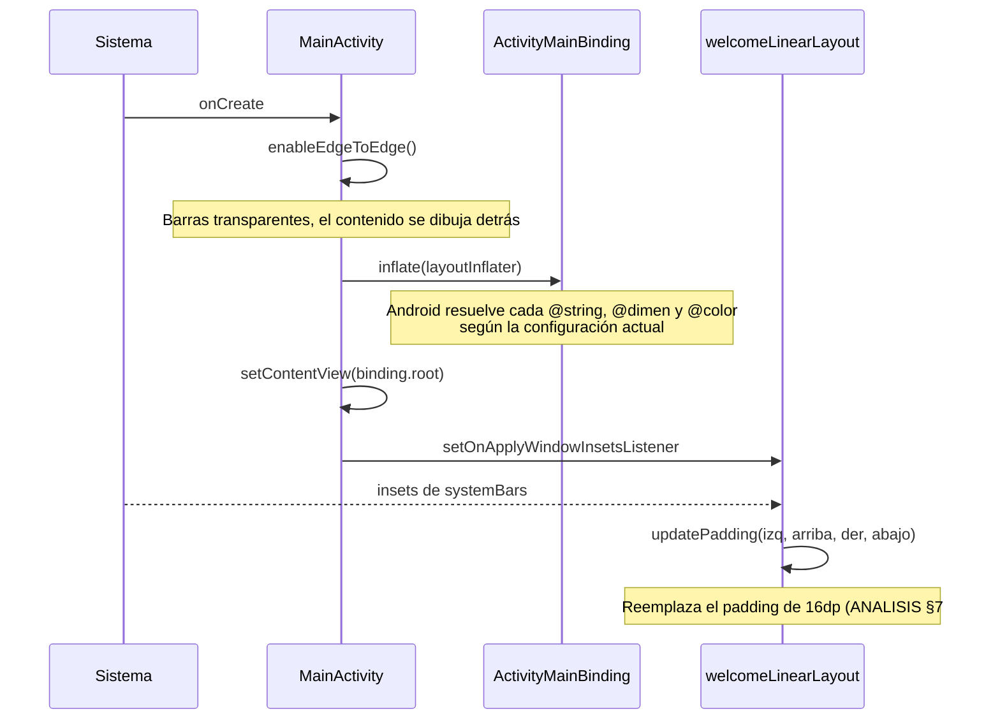
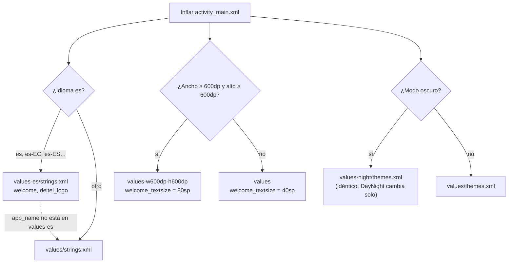

# WelcomeApp — Arquitectura

Cómo está organizada la app, cómo Android elige sus recursos y por qué se tomó cada decisión. Los principios se analizan en [ANALISIS_DISENO.md](ANALISIS_DISENO.md).

> Las rutas son relativas a `app/src/main/`.

---

## 1. Vista general

- **Pantallas:** una Activity (`ui/welcome/MainActivity.kt`) y un layout (`res/layout/activity_main.xml`).
- **Estado:** ninguno. No hay ViewModel porque no hay nada que conservar.
- **Código:** solo configura la ventana (edge-to-edge e insets). Todo lo visible sale de recursos.

### Árbol de vistas

```
LinearLayout  @+id/welcomeLinearLayout   vertical, match_parent
├── TextView  @+id/welcomeTextView       height 0dp, weight 1, gravity center
│             text      @string/welcome
│             textSize  @dimen/welcome_textsize
│             textColor @color/welcome_text_color
└── ImageView @+id/bugImageView          height 0dp, weight 1
              src                @drawable/bug
              contentDescription @string/deitel_logo
```

Los dos hijos tienen `layout_weight="1"`, así que cada uno recibe 1/2 de la altura (PDF 2.5.10). `layout_height="0dp"` evita que el `LinearLayout` mida dos veces a cada hijo (Lint `InefficientWeight`).

---

## 2. Arranque



---

## 3. Resolución de recursos

Android elige los recursos sin código, comparando la configuración del dispositivo con los calificadores de cada carpeta.



| Configuración           | Tamaño en dp (aprox.) | `welcome_textsize` | Textos       |
| ----------------------- | --------------------- | ------------------ | ------------ |
| Pixel 7 vertical        | 411 × 914             | 40sp               | Según idioma |
| Pixel 7 horizontal      | 914 × 411             | 40sp (alto < 600)  | Según idioma |
| Pixel Tablet horizontal | 1280 × 800            | 80sp               | Según idioma |
| Pixel Tablet vertical   | 800 × 1280            | 80sp               | Según idioma |

- **`w600dp-h600dp` exige ambas dimensiones**, así que un teléfono en horizontal (muy ancho, pero bajo) sigue usando 40sp. Con `sw600dp` pasaría lo mismo; el PDF eligió dos calificadores separados.
- **`es-EC` usa `values-es`:** desde API 24, Android busca el idioma padre cuando no hay una carpeta de la región. El minSdk 24 garantiza ese comportamiento.
- **`app_name` es `translatable="false"`**, así que el nombre "WelcomeApp" es el mismo en todos los idiomas.

---

## 4. Qué pasa al rotar

1. Android destruye y recrea la Activity.
2. Se vuelve a inflar el layout y los recursos se resuelven con la nueva configuración. En teléfono sigue siendo 40sp; en tablet, 80sp en ambas orientaciones.
3. No se pierde nada: la app no tiene estado. Por eso no hace falta ViewModel ni `onSaveInstanceState`.

---

## 5. Estructura de paquetes y recursos

```
ec.edu.uta.fisei.welcomeapp
├── core/                       vacío (.gitkeep)
├── domain/{model,repository,usecase}/   vacíos (.gitkeep)
├── data/repository/            vacío (.gitkeep)
└── ui/welcome/
    └── MainActivity.kt         Edge-to-edge e insets

res/
├── layout/activity_main.xml    LinearLayout + TextView + ImageView
├── drawable/bug.png            Imagen del PDF (sin calificador de densidad)
├── drawable/ic_launcher_*.xml  Capas del ícono adaptativo, sin uso (ANALISIS §7 #5)
├── mipmap-*dpi/                Ícono de plantilla en PNG/WebP
├── values/                     strings, dimens (40sp), colors, themes
├── values-es/strings.xml       welcome, deitel_logo
├── values-w600dp-h600dp/       dimens (80sp)
├── values-night/themes.xml     Copia del tema claro
└── xml/                        Reglas de respaldo de plantilla
```

La razón de las carpetas vacías está en [ANALISIS_DISENO.md §2](ANALISIS_DISENO.md).

---

## 6. Decisiones de arquitectura

| #   | Decisión                                | Alternativa descartada             | Motivo                                                                             |
| --- | --------------------------------------- | ---------------------------------- | ---------------------------------------------------------------------------------- |
| 1   | Vistas XML                              | Jetpack Compose                    | Fidelidad al PDF, que es el objeto de la práctica                                  |
| 2   | `LinearLayout` con pesos                | `ConstraintLayout` de la plantilla | Lo pide el PDF (2.5.3), y "dos mitades apiladas" se expresa directamente con pesos |
| 3   | Sin ViewModel ni capas activas          | MVVM como en P05                   | No hay estado ni lógica (YAGNI)                                                    |
| 4   | ViewBinding                             | `findViewById`                     | Seguro en tipos; se usa solo para el listener de insets                            |
| 5   | Insets en el layout raíz                | Insets en cada hijo                | Un solo punto. Costo: reemplaza el padding (ANALISIS §7 #1)                        |
| 6   | Tamaño de texto por recurso alternativo | Calcularlo en código               | Android lo elige solo; un tamaño nuevo es una carpeta nueva                        |
| 7   | Un solo color para claro y oscuro       | `values-night/colors.xml`          | Simplicidad. Costo: unos 3:1 en oscuro (ANALISIS §7 #4)                            |
| 8   | Paquetes por capas vacíos               | Solo `ui/welcome`                  | Convención común del curso (ANALISIS §2)                                           |
